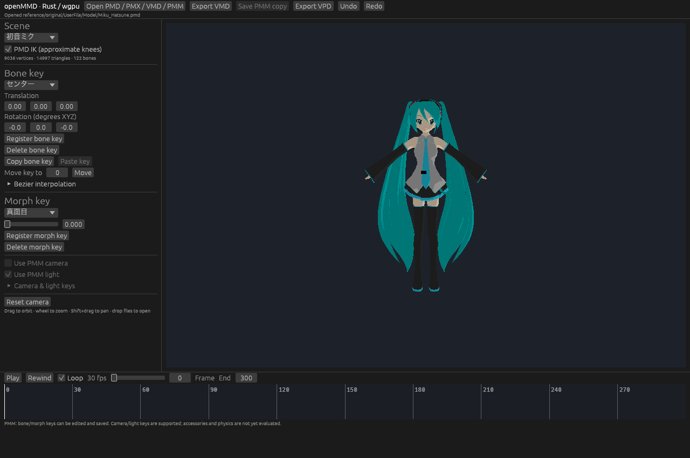
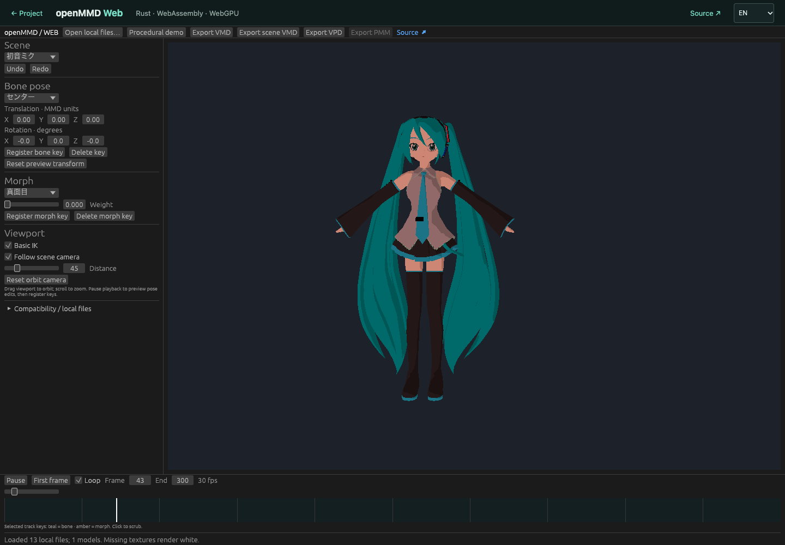

# openMMD

Новая реализация части MikuMikuDance 9.32 на Rust, wgpu и egui.
Цель — редактор для macOS, Windows и Linux с совместимостью PMM.
**Текущая версия — ранний редактор, не полный порт MMD.**

[Веб-редактор](https://lakomoor.github.io/openMMD/app/) ·
[Сайт и скриншоты](https://lakomoor.github.io/openMMD/) ·
[Исходный код](https://github.com/LakoMoor/openMMD)



## Браузерная версия

Работает на Rust + WebAssembly + WebGPU, с общими парсерами, анимацией и
рендерером. Выбирайте модель и её текстуры вместе; для PMM нужны его модели.
Файлы остаются в текущей вкладке. Есть процедурный демориг без сторонних моделей,
воспроизведение, правка костных/морф-ключей, Undo/Redo и экспорт PMM/VMD/VPD.
Нужен современный Chrome/Edge с WebGPU и аппаратным ускорением. На узких экранах
панель Inspector открывается поверх сцены, а экспорт перенесён в меню Tools.
[Сборка и точные ограничения веб-версии](docs/web.md).



## Запуск

Нужен установленный stable Rust 1.92+ и графический адаптер с поддержкой wgpu.

```sh
cargo run --release
cargo run --release -- path/to/model.pmd
cargo run --release -- path/to/project.pmm
```

Можно перетаскивать PMD, PMX, VMD и PMM в окно. Для костной анимации сначала
загрузите модель; VMD камеры/света можно открыть отдельно.
Редактируйте позицию/вращение кости или вес морфа, затем нажмите Register.
Доступны копирование, перенос ключей и настройка входящих Bezier-кривых.
Ключ регистрируется на ближайшем целом кадре. Play воспроизводит анимацию
с частотой 30 кадров/с. Колесо меняет масштаб, drag вращает камеру,
Shift+drag перемещает её цель. Все загруженные модели отображаются в одной сцене.

## Что реализовано

- PMD 1.0: геометрия, материалы, diffuse-текстуры, скелет, vertex morphs.
- Базовый PMX 2.0/2.1: геометрия, материалы, четыре веса на вершину, скелет,
  vertex morphs. SDEF/QDEF приближены линейным skinning.
- VMD 0002: костные/морф-ключи, камера/свет, видимость и переключатели IK,
  Bezier-интерполяция и slerp.
  Self-shadow, видимость, IK-switch keys и неизвестные дополнительные данные
  сохраняются при повторном экспорте. [Подробности VMD](docs/vmd.md).
- CPU skinning и CCD IK с приближёнными ограничениями коленей PMD.
- Viewport wgpu с depth buffer, diffuse-текстурами и упрощённым toon-шейдером.
- Выбор модели/кости/морфа, таймлайн, просмотр и правка ключей, Undo/Redo
  для анимации выбранной модели.
- Чтение костной/морф-анимации существующих PMM v1/v2. Для v1 нужны исходные
  PMD-модели: проект не содержит полной схемы скелета.
- Сохранение копии существующего PMM с изменением, добавлением и удалением
  костных/морф-ключей. Остальные байты сохраняются. Повторяющиеся имена костей
  могут быть неоднозначны: такая правка отклоняется вместо угадывания.

Нулевой ключ PMM обязателен: если удалить его из дорожки, при сохранении
восстановится нейтральный ключ. Полные детали — [PMM](docs/pmm.md),
[PMX](docs/pmx.md), [объект исследования и оставшаяся работа](docs/analysis.md).

- PMM-камера/свет: playback, правка и сохранение ключей, отдельная история Undo.
  Привязка камеры и преобразования пока не сверены с оригинальным runtime.
- VPD: импорт и экспорт костных поз.

## Ограничения

Аксессуары X, звук, фон, тени, toon/sphere-текстуры и физика
пока не воспроизводятся и не редактируются. Их исходные секции PMM сохраняются
как непрозрачные данные. Расширенные свойства костей и другие типы морфов PMX
не вычисляются; soft bodies отклоняются. Полное визуальное совпадение с MMD
не обеспечено. Камера viewport может следовать PMM или переключаться на свободный обзор.

Export VMD сохраняет все загруженные дорожки; Export scene VMD экспортирует
камеру/свет сцены отдельно. Self-shadow сохраняется без воспроизведения.
Перенос self-shadow, видимости и переключателей IK из VMD в PMM ещё не реализован,
и сохранение таких правок в PMM возвращает ошибку вместо потери данных. Сохранение PMM работает с существующим проектом:
создание новой сцены PMM, изменение состава моделей не реализованы. Desktop-сохранение обновляет пути
моделей на реальные абсолютные пути текущей системы; при переносе проекта на
другой компьютер ресурсы нужно разместить заново. Поле PMM ограничивает пути
255 байтами Shift-JIS: неподходящий путь возвращает ошибку вместо порчи проекта.
Отредактированные файлы пока не проверены загрузкой в оригинальном Windows MMD.

Фактический GUI/GPU-запуск проверен на macOS / Apple M4 / Metal и в Chrome WebGPU.
CI собирает приложение и запускает обычные тесты на macOS, Windows и Linux;
графическое воспроизведение на Windows/Linux ещё не проверено.

## Проверка на оригинальных файлах

Оригинальное приложение и ресурсы не входят в проект. Скрипт скачивает именно
указанный дистрибутив и проверяет SHA-256. EXE не запускается.

```sh
python3 scripts/fetch_reference.py
cargo run --release -- reference/original/UserFile/sample.pmm
cargo test --locked
cargo test --locked -- --ignored --nocapture
cargo clippy --locked --all-targets -- -D warnings
cargo fmt --all --check
```

Ignored-тесты требуют скачанные файлы; один из них также требует GPU, рисует
оригинальную Miku и записывает `reference/preview.png`. Тесты проверяют все
13 комплектных PMD, три PMM v1, синтетические PMM v2/PMX, сохранение ключей,
целостность не изменяемых байтов, skinning и повреждённые входные данные.

Снимок самого окна для ручной проверки можно получить так:

```sh
MMD_TEST_SCREENSHOT=reference/editor.png cargo run -- reference/original/UserFile/sample.pmm
```

В этом режиме приложение снимает только собственное окно и завершает работу.

## Исходники

- `src/format.rs` — PMD/VMD, общие структуры сцены.
- `src/pmx.rs` — PMX.
- `src/pmm.rs` — PMM и сохранение изменений.
- `src/animation.rs` — интерполяция, иерархия скелета, IK, skinning.
- `src/editor.rs` — операции над ключами и история.
- `src/renderer.rs`, `src/model.wgsl` — GPU viewport.
- `src/main.rs` — desktop-интерфейс и загрузка сцены.
- `src/web.rs` — WASM-интерфейс, локальные файлы и браузерный экспорт.

Для бинарных форматов использованы открытые описания реализации nanoem и
MMD Tools; ссылки и границы проверки указаны в документации. Лицензии
оригинального дистрибутива и моделей этим проектом не изменяются.

## MMD 9.32 parity

Exact behavior is the target, but the editor is not yet a 1:1 port.
[Reference identity, binary findings and remaining acceptance work](docs/parity.md).
