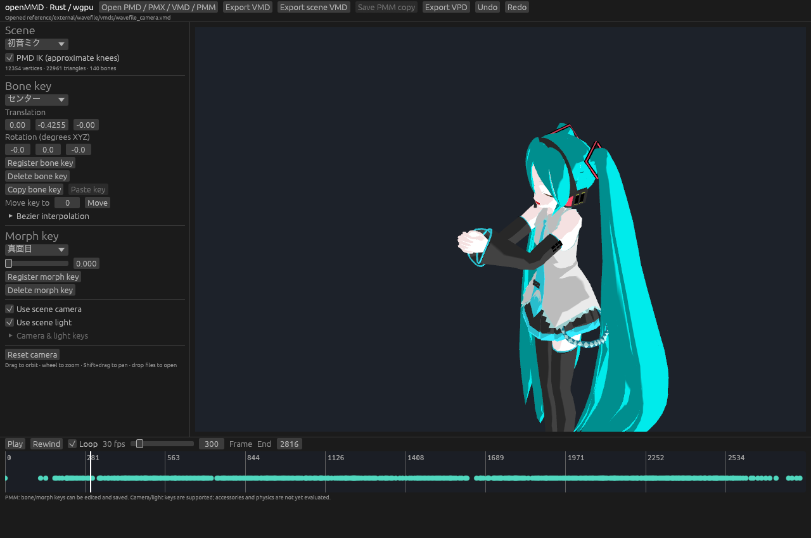

# Models and reference scenes

The exact visual target is [Ryuki M426 MMD's MONSTER video](https://www.youtube.com/watch?v=QWlSmG9qApk).
Its YouTube oEmbed confirms the title and author. The asset/effect list was found
in a [description mirror](https://www.nicozon.net/tag/どっと式初音ミク/v/d/1), rather than
verified from the original downloadable archives. See `catalog.json` for the
model, motion, camera, stage and accessory source links and verification status.

The video uses MMD together with MME effects and AviUtl. Matching this appearance
requires more than the native MMD material pipeline: shadows, AO, depth of field,
glow, reflections and postprocessing must also match. These effects are not yet
implemented in openMMD. A matching renderer is the goal, not the current status.

## A reproducible local test set

```sh
python3 scripts/fetch_examples.py
cargo run --release -- reference/external/wavefile/miku/miku_v2.pmd \
  reference/external/wavefile/vmds/wavefile_v2.vmd \
  reference/external/wavefile/vmds/wavefile_camera.vmd
```

The native command accepts model, motion and camera files in order. Alternatively,
in the application, open `reference/external/wavefile/vmds/wavefile_v2.vmd`, then
`wavefile_camera.vmd`. In the browser, select the PMD, BMP and both VMD files
together. Files stay local. The fetcher downloads original notices first, records
all source URLs and SHA-256 hashes, and pins the upstream commit. It downloads no
music. Model and motion licenses are separate from openMMD's MIT license.

For the original MMD multi-model PMM examples, use the original LearnMMD archive
already described in the repository guide. `sample.pmm`, `sample(AllStar).pmm`
and `sample(follow_camera).pmm` refer to their accompanying UserFile models.
They are reference files, not assets bundled with openMMD.

## Additional scenes

[Remote Control stage](https://www.deviantart.com/luciing/art/MMD-Remote-Control-Stage-DL-1144434608)
includes a PMM configuration, stage animation and effects according to its
creator. The creator states noncommercial/attribution conditions. Full playback
is unverified; several required systems are not implemented yet. Download from
the author and retain the included readme and credits.

[Helltaker-like dance](https://bowlroll.net/file/243140) is an additional motion
candidate. Its author video is linked in the catalog. A mirror describes it as
CC0, but its actual archive has not been verified; the catalog does not treat
that description as permission to bundle it.

Shared toon maps are copied into the local pack only when the original MMD
archive has already been extracted under `reference/original`. Otherwise obtain
the original distribution and select its `Data/toon*.bmp` files too; missing
toon maps produce an explicit fallback warning. They are not bundled with openMMD.

## Current native rendering



Captured on macOS with the outline pass enabled and the model, motion and camera fetched by the script below. Model: Animasa / Crypton Future Media; motion: hino; camera: doramata. This documents the current renderer, not visual parity with MMD or the MONSTER reference.

## Synthetic SDEF example

[Two-bone PMX strip and VMD bend](sdef/) are original MIT-licensed test assets for checking spherical deformation without downloading a character model.
