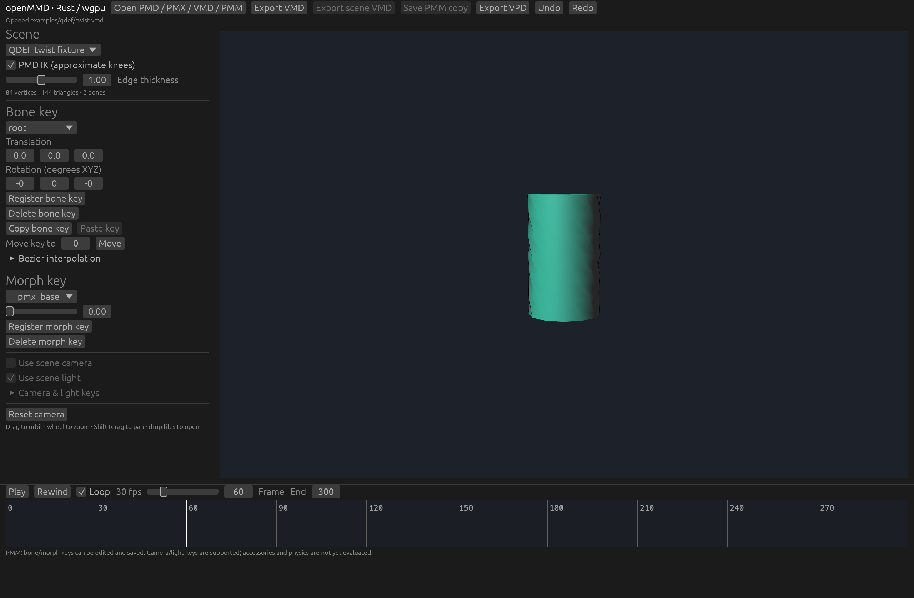

# Synthetic QDEF twist

Original openMMD test assets under the repository's MIT license. No third-party models, motions or textures are included.

Open `cylinder.pmx` and `twist.vmd` together. At frame 60 the upper bone has rotated 120 degrees around the cylinder's Y axis. The PMX 2.1 mesh has 84 QDEF vertices, 144 triangles and two bones, with weights varying along its height.

For a direct comparison, open `cylinder_bdef.pmx` with the same motion in a separate editor session. Its only difference is the skinning mode byte at every vertex (BDEF4 instead of QDEF).

The radius is 3 units before and after QDEF deformation. Evaluating the same vertex weights with linear blending shrinks the middle ring to radius 1.5. `tests/qdef.rs` imports these exact files and checks both outcomes.

This is a mathematical and application smoke test, not a capture from original Windows MMD. See [PMX compatibility](../../docs/pmx.md#qdef-implementation-boundary) for the remaining limits.

